# How the CROPS payment rail works

Reference design companion to [build-prompt-crops-payment-system.md](build-prompt-crops-payment-system.md). The build prompt sets the requirements; this document explains how the suggested architecture in its section 4 meets them, with diagrams. Nothing here has been built. Where the design has an open question or a known tension, it is marked **Open** and belongs in the builder's `docs/decisions.md`.

Status: draft, not reviewed. The failure counts it refers to come from seed ratings that are pending human review.

Diagrams are Mermaid, so they render on GitHub and in most Markdown viewers, and they are diffable text that the builder keeps current (build prompt, section 7).

## Contents

1. [Design rule](#1-design-rule)
2. [Components](#2-components)
3. [Who can move funds](#3-who-can-move-funds)
4. [Invoice and pay](#4-invoice-and-pay)
5. [Relayed submission and fallback](#5-relayed-submission-and-fallback)
6. [What is public and what is not](#6-what-is-public-and-what-is-not)
7. [Batch payouts and refunds](#7-batch-payouts-and-refunds)
8. [Escrow](#8-escrow)
9. [Reconciliation, notification and auditor access](#9-reconciliation-notification-and-auditor-access)
10. [Edge screening](#10-edge-screening)
11. [Inherited risk: tokens and chains](#11-inherited-risk-tokens-and-chains)
12. [Walkaway: what still works if the authors disappear](#12-walkaway-what-still-works-if-the-authors-disappear)
13. [Deployment and verification](#13-deployment-and-verification)
14. [CI pipeline and how it produces the evidence](#14-ci-pipeline-and-how-it-produces-the-evidence)
15. [Acceptance through the dashboard](#15-acceptance-through-the-dashboard)
16. [Criteria map](#16-criteria-map)
17. [Open questions](#17-open-questions)

## 1. Design rule

In the seed assessment, 15 or 16 of the 17 onchain rails scored 0 on C1, C2, C3, F1 and F3. In almost every case the cause was the same: completing a payment needed a service only the provider runs, such as a relayer, a price signer, a backend or a card issuer. The design therefore starts from one rule:

> A payment completes with the public contracts, a wallet and any RPC endpoint. Everything else is optional.

The diagrams below separate the **required path** (solid lines, green) from **optional services** (dashed lines, grey). If a component appears only on dashed lines, removing it must not stop any payment.

## 2. Components

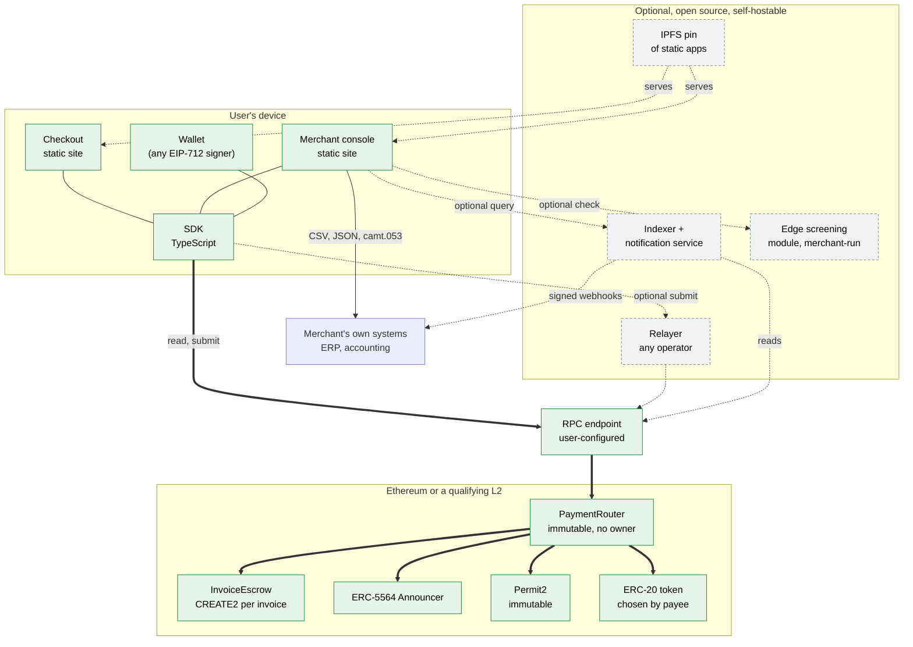

| Component | Required | What it does | Who runs it |
| --- | --- | --- | --- |
| `PaymentRouter` | Yes | Moves exactly the authorised amount from payer to payee in one call. Emits `Paid`. Also `payBatch` and `refund`. | Nobody. Deployed once per chain, no owner. |
| `InvoiceEscrow` | Only for escrowed invoices | Holds funds for one invoice. Address is derived from the invoice hash. | Nobody. Deployed on first use by whoever funds it. |
| ERC-5564 Announcer | Yes, when stealth receiving is used | Publishes the ephemeral key so the payee can find the payment. | Nobody. A singleton contract. |
| Permit2 | Only for tokens without EIP-3009 | Signature-based exact transfers. | Nobody. Existing immutable contract. |
| SDK | Yes | Builds and verifies invoices, produces authorisations, submits, scans, exports. | Runs on the user's device. |
| Checkout, console | One of them, or any wallet that speaks the invoice format | User interface. All state stays local or in exported files. | Static files: anyone can host them, or open them from a local copy. |
| RPC | Yes, any one | Reads and broadcasts transactions. | User's choice, including their own node. |
| Relayer | No | Pays gas for the payer in exchange for a signed fee. Cannot change terms. | Anyone. At least two independent defaults. |
| Indexer and notifications | No | Faster lookup and signed webhooks. | Anyone, typically the merchant. |
| Edge screening | No | Merchant-side check against a named list. | The merchant that needs it. |

## 3. Who can move funds

This is the diagram a risk committee should read first. It shows every party and every power it holds over money. The gaps matter as much as the arrows: there is no box for "the provider".

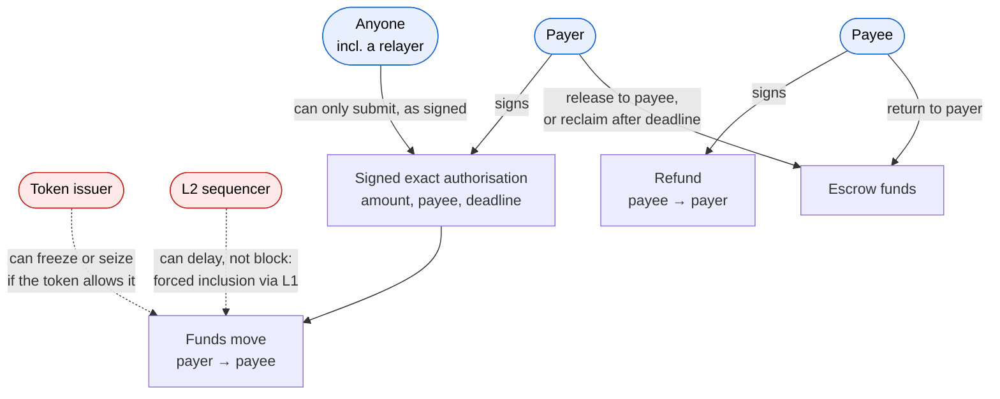

The red parties are inherited risks. The rail cannot remove them; it can only disclose them before the payee accepts a token or chain (section 11). That disclosure is what C5 scores.

## 4. Invoice and pay

### The invoice

An invoice is an EIP-712 typed message, signed by the payee, created entirely offline:

| Field | Purpose |
| --- | --- |
| `chainId`, `router` | Which deployment settles it. |
| `token`, `amount` | What is owed. |
| `deadline` | After this, the invoice cannot be paid. |
| `stealthMetaAddress` | Payee's ERC-5564 spending and viewing public keys. The payer derives a one-time address from it. |
| `salt` | Random 32 bytes. Makes the onchain commitment unlinkable to the invoice content. |
| `memo` (optional) | Encrypted to the payee's viewing key. Never onchain in plaintext. |
| `escrow` (optional) | Whether settlement goes through an `InvoiceEscrow`. |

The payment reference that appears onchain is

```
commitment = keccak256(invoiceHash, salt)
```

Only someone holding the invoice can link the commitment to it.

The invoice travels as a URL fragment (`#…`, which browsers never send to the server hosting the page) or as a QR code. No server stores it.

### The payment

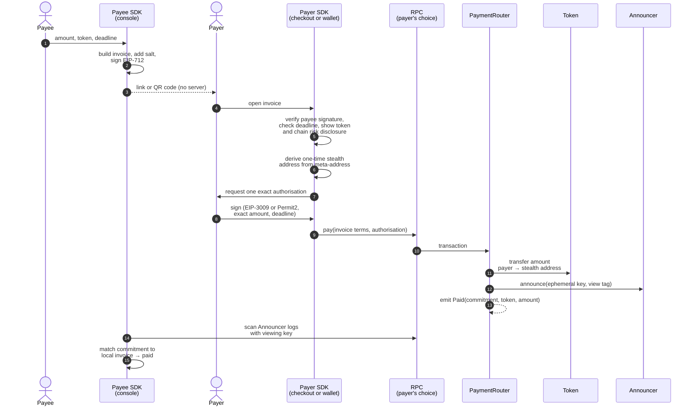

Steps 1 to 4 need no network at all. Steps 9 to 12 are one atomic transaction: either the payee receives the full amount or nothing happens. At no point does a contract hold the funds (S1).

### Authorisation types

| Token supports | Mechanism | Allowance left behind |
| --- | --- | --- |
| EIP-3009 | `transferWithAuthorization`, with `nonce = commitment`. | None. |
| Anything else | Permit2 `permitWitnessTransferFrom`, with the invoice terms as the witness. | See **Open 1** below. |

Using the commitment as the EIP-3009 nonce has a useful side effect. If someone submits the authorisation directly to the token, bypassing the router, the payment still settles to the right address, and the token's own `AuthorizationUsed(payer, nonce)` event still carries the commitment. Reconciliation works from either event.

**Open 1.** Permit2 needs the payer to approve the Permit2 contract once, and wallets usually make that approval unlimited. The build prompt's S3 requirement fails on any approval above the payment amount. The builder has two choices: approve Permit2 for the exact amount on each payment (one extra transaction), or prefer EIP-3009 tokens and support Permit2 only as an exact-approval fallback. Record the choice.

## 5. Relayed submission and fallback

A payer without gas can use a relayer. The relayer is paid out of the authorisation itself, so it never needs an account, an API key or a relationship with anyone.

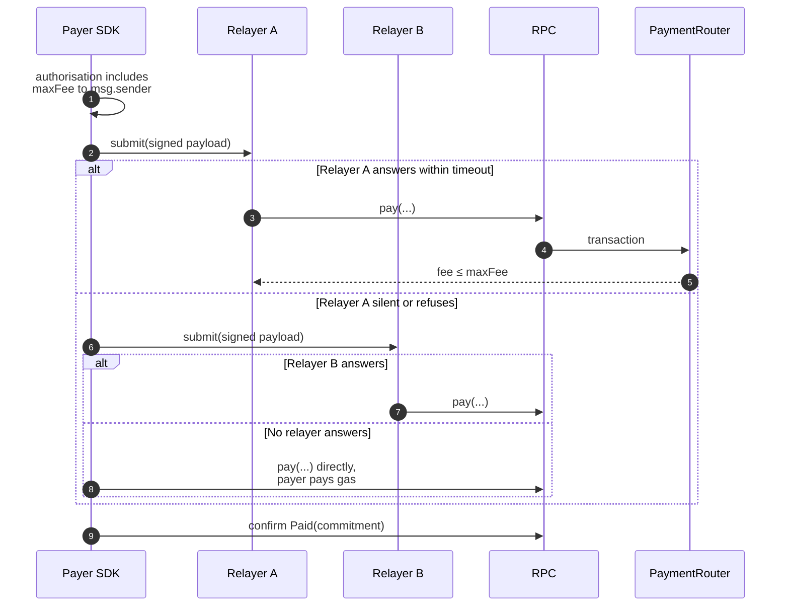

What a relayer can and cannot do:

| Can | Cannot |
| --- | --- |
| Refuse to submit, or submit late. The SDK moves to the next relayer, then to direct mode. | Change the payee, amount, token or deadline. These are inside the signature. |
| Take up to `maxFee`. | Take more than `maxFee`, or take it if the payment fails. |
| See the payer's address and the authorisation, which become public onchain anyway. | See the invoice memo, which is encrypted to the payee. |

Because the fee goes to `msg.sender`, anyone can relay. No allowlist exists, so none can be abused (C1, C2).

## 6. What is public and what is not

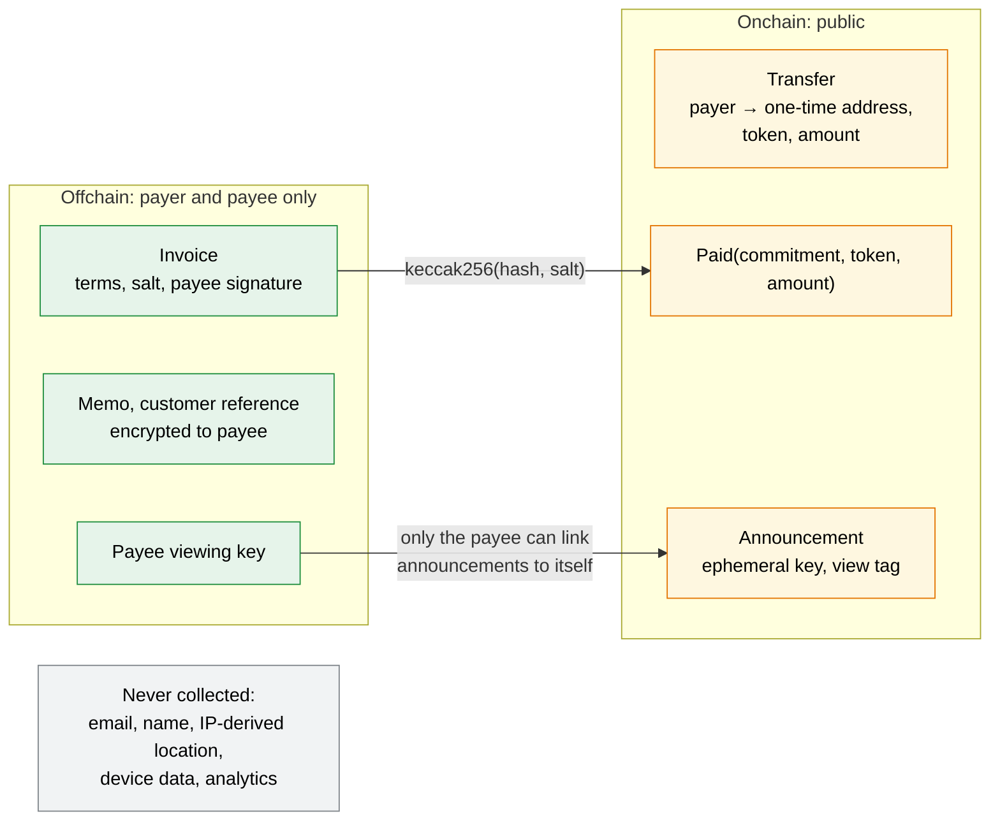

What an observer of the chain learns:

- that the payer's address paid some amount of some token to an address that has never been seen before;
- not who the payee is, unless the payee later moves the funds in a way that links the addresses (**Open 2**);
- nothing about what the payment was for.

What this design does not hide: the payer's address and the amount. Payer privacy is milestone 4 (a shielded mode) and must not be claimed before it exists.

**Open 2.** Funds at a one-time address need gas before they can be moved, and consolidating many one-time addresses into one reveals that they share an owner. The builder should document how a payee sweeps funds (for example through an ERC-4337 paymaster, or by sweeping each address to a separate destination), and state plainly in the self-review that careless consolidation undoes the payee's privacy.

## 7. Batch payouts and refunds

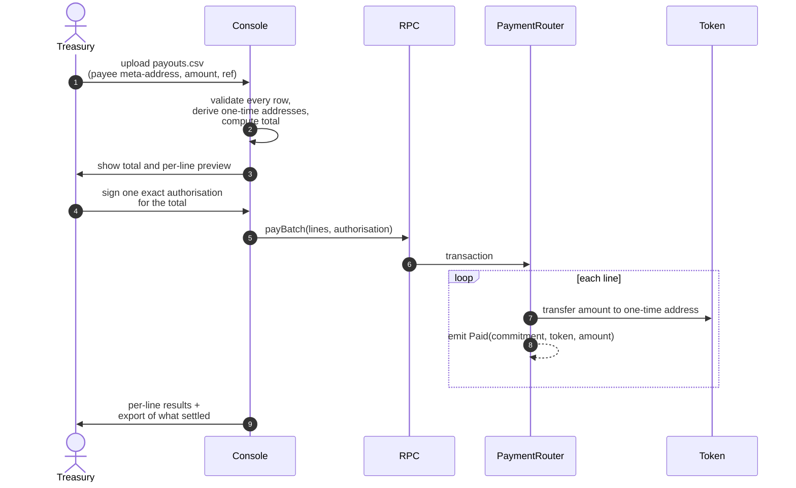

A batch is atomic: if any line reverts, none settle, and the console reports which line failed. **Open 3**: if the builder chooses partial success instead, the authorisation must still be exact, and unpaid amounts must never sit in the router.

A refund is an ordinary payment in the opposite direction. The payee signs an authorisation from the one-time address that received the funds, the router sends up to the original amount back to the payer's address, and it emits `Refunded(commitment, amount)`. The router checks only that the refund references a real `Paid` commitment. It does not hold or track balances.

## 8. Escrow

For delivery-versus-payment, the invoice can require escrow. The escrow contract is deployed by CREATE2 at an address derived from the invoice hash, so both sides know the address before anything is deployed, and nobody has to be trusted to deploy the right code.

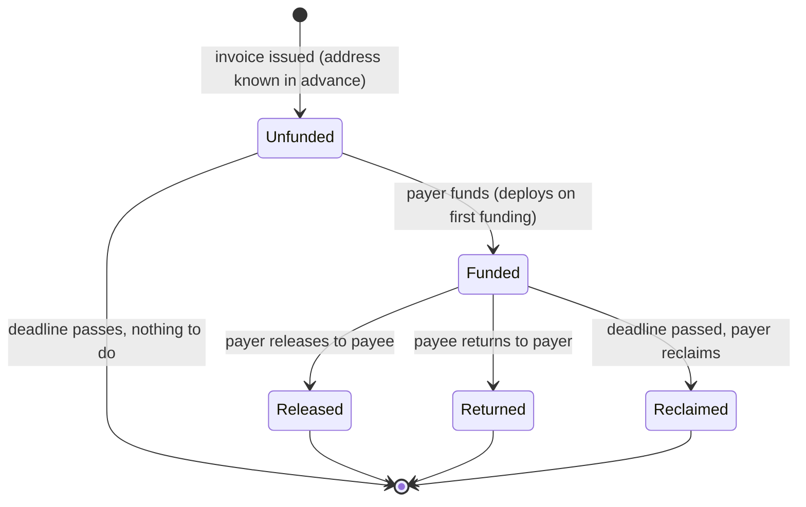

The contract has exactly three functions, `release`, `returnFunds` and `reclaim`. It has no owner and no function that can send funds anywhere except the payer or payee named in the invoice.

**Open 4.** A two-party escrow protects the payer, not the payee: a payer can receive goods and then reclaim after the deadline. Release is by the payer: a payee who could release funds to itself would make the escrow pointless. An earlier draft of the build prompt had this the wrong way round and has been corrected. Seller protection needs a third party, which the parties would name in the invoice themselves, for example as a 2-of-3 signer set. That party is chosen per invoice by payer and payee, never by the rail. The builder should decide whether to support it in milestone 1 or later.

## 9. Reconciliation, notification and auditor access

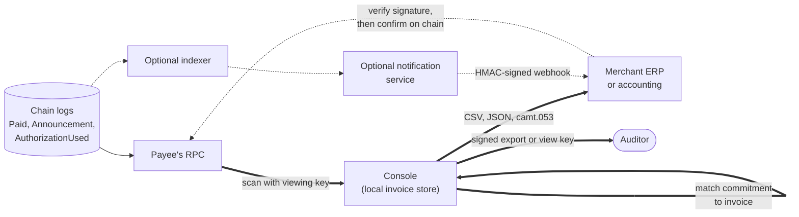

- The console is the required path: it rebuilds the payee's records from the chain and its own invoice files at any time. Losing the indexer loses speed, not records.
- Webhooks are signed, and the repo ships verification code that uses a constant-time comparison. The merchant's system should still confirm the payment onchain before releasing goods, because a webhook is a notification, not proof (S5).
- An auditor gets either a signed export or a view key. A view key reveals which announcements belong to that payee and nothing about any other payee.

## 10. Edge screening

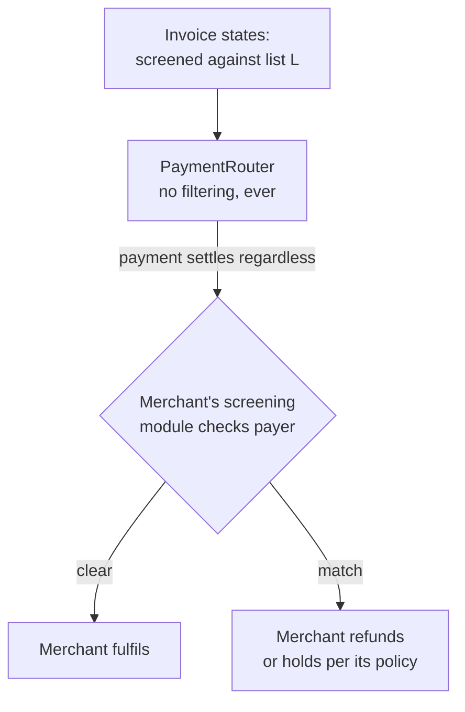

Screening is a decision the merchant makes about its own business. It runs after settlement, in the merchant's systems, against a list the invoice names. The contracts never see it. A payer who wants to know whether screening applies reads the invoice before paying (C4).

## 11. Inherited risk: tokens and chains

The rail cannot remove an issuer's power to freeze a token or a sequencer's power to delay a transaction. It can make sure the payee knows before accepting.

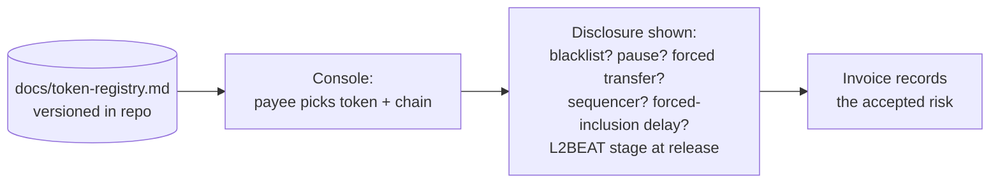

Each registry entry states, per token and chain:

| Field | Example values |
| --- | --- |
| Issuer can blacklist addresses | yes / no |
| Issuer can pause transfers | yes / no |
| Issuer can force-transfer or burn | yes / no |
| Upgradeable token contract, and who controls it | proxy admin, timelock length |
| Chain sequencer | single operator / decentralised |
| Forced-inclusion path and delay | stated per chain |
| Proof system and L2BEAT stage | recorded with date |

At least one supported token should have no issuer freeze power, so a payee has a real choice.

## 12. Walkaway: what still works if the authors disappear

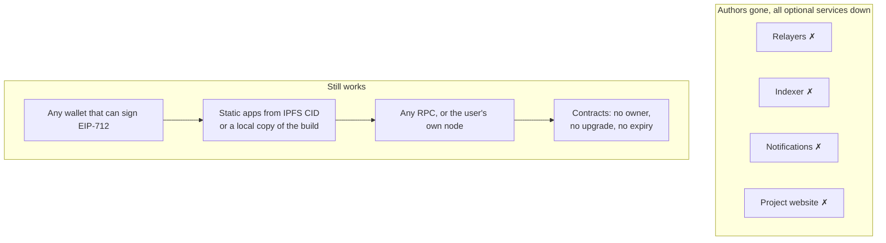

CI proves this on every commit by running the full flow set with every optional service disabled (build prompt, section 5, step 3). That run is the S4 evidence.

## 13. Deployment and verification

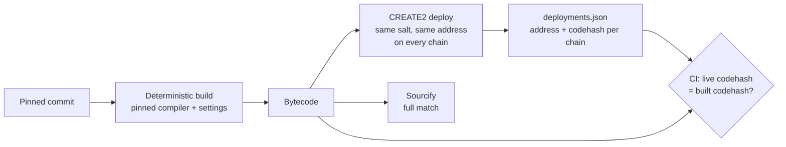

A user checks a deployment by building the pinned commit and comparing the codehash with the address on any chain. The address is the same everywhere because CREATE2 depends only on the deployer, the salt and the code (O1).

## 14. CI pipeline and how it produces the evidence

Each CI job produces a file that a dashboard criterion cites. The two jobs that matter most are the ones no assessed rail had: a recorded self-host run and a recorded network trace.

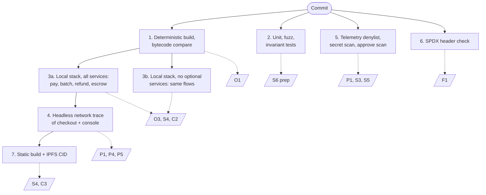

## 15. Acceptance through the dashboard

The system is assessed by the same tool that assessed the 32 existing rails, with no special treatment.

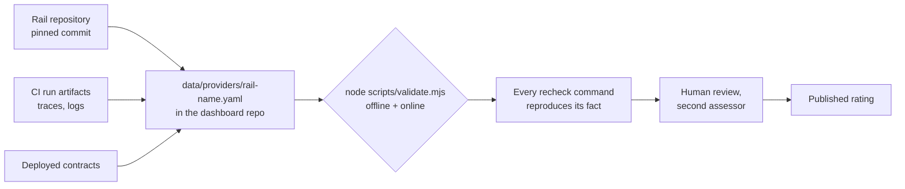

Before milestone 3, S6 (audits and bounty) can be at most 2, with the reason stated. Every other criterion is expected at 3 from milestone 1.

## 16. Criteria map

Where each criterion is met in this design.

| Criterion | Met by | Section |
| --- | --- | --- |
| C1 admin powers | No owner or role in any contract | 2, 3 |
| C2 settle without provider | Permissionless `pay`, direct-mode fallback | 4, 5 |
| C3 hosted dependence | Every service optional, two default relayers, static apps on IPFS | 2, 5, 12 |
| C4 neutral settlement | Screening only at the merchant's edge, disclosed on invoice | 10 |
| C5 inherited freeze | Token and chain registry shown at selection | 11 |
| O1 verified contracts | Deterministic build, CREATE2, Sourcify full match | 13 |
| O2 full stack public | Every component in one public repo | 2 |
| O3 self-host | CI local-stack job | 14 |
| O4 interfaces and export | ABIs, OpenAPI, CSV/JSON/camt.053 | 9 |
| F1, F2, F3 | MIT or Apache-2.0, DCO, no closed component | 2, 14 |
| P1 telemetry | None; CI trace and denylist | 6, 14 |
| P2 data collection | Protocol fields only; memo encrypted | 4, 6 |
| P3 onchain linkability | One-time addresses, salted commitment | 4, 6 |
| P4, P5 third parties, endpoints | Only user-configured RPC required; all URLs settable | 2, 14 |
| S1 custody in flight | Atomic transfer; escrow only payer and payee | 3, 4, 8 |
| S2 upgrade authority | Non-upgradeable | 13 |
| S3 approval scope | EIP-3009 or exact Permit2 | 4 |
| S4 walkaway | Contracts plus static apps plus any RPC | 12 |
| S5 secrets and webhooks | No client secrets; signed webhooks; onchain confirmation | 9 |
| S6 audits and bounty | Milestone 3 | 15 |

## 17. Open questions

These are for the builder's `docs/decisions.md`. None is settled by this document.

| # | Question | Hinges on |
| --- | --- | --- |
| 1 | Exact per-payment approval to Permit2, or EIP-3009 tokens only? | Gas cost per payment versus S3 at 3 |
| 2 | How payees sweep one-time addresses without linking them | Paymaster availability per chain |
| 3 | Atomic or partial-success batches | Treasury preference; S1 must hold either way |
| 4 | Optional arbiter for seller-protected escrow, and in which milestone | Demand from institutional users |
| 5 | Who operates the two default relayers, and how they are funded | Independence evidence for C3 and the self-review |
